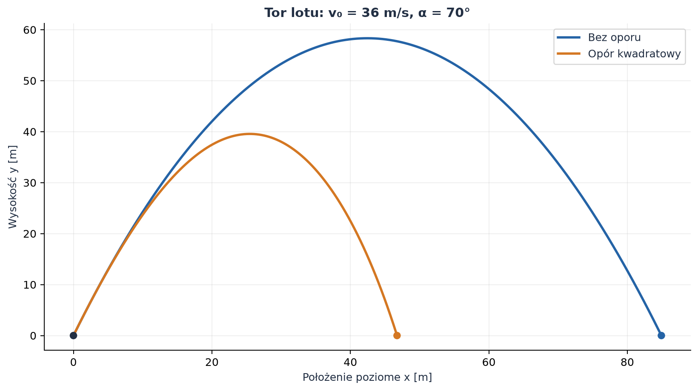
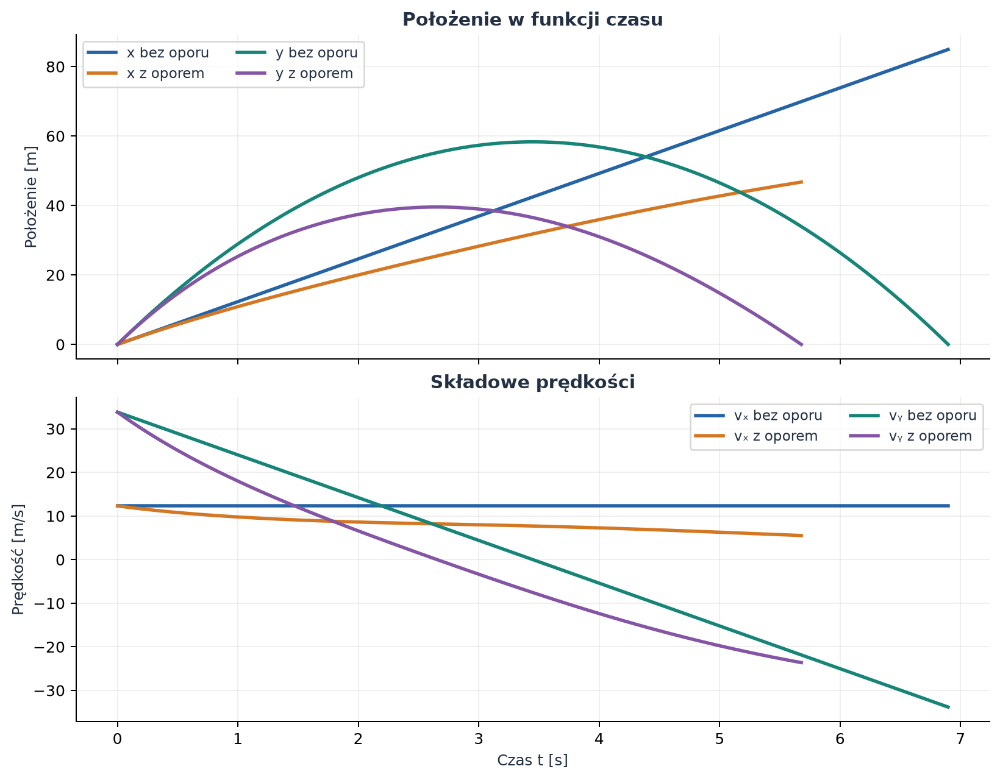
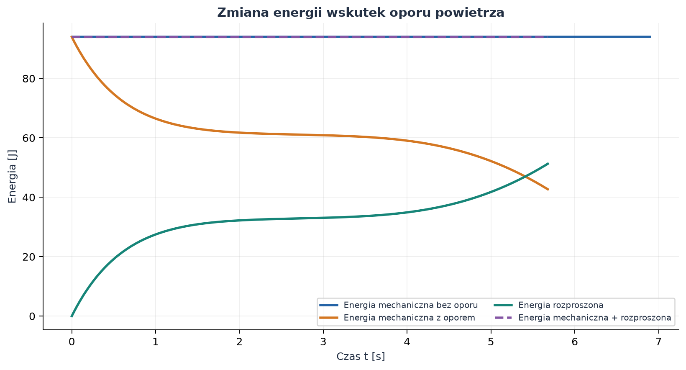
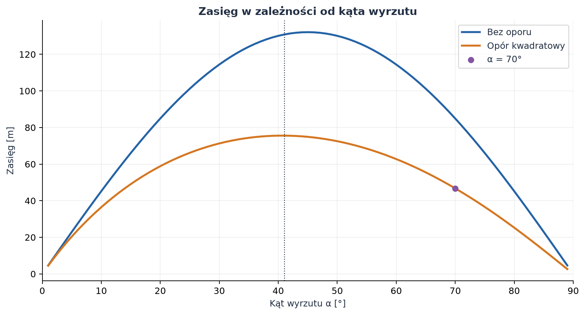

 # Rzut ukośny — od modelu idealnego do oporu powietrza

*Raport obliczeniowy i przykład wykorzystania Markdown, równań matematycznych oraz wykresów wygenerowanych w Pythonie.*

**Temat:** ruch ciała wyrzuconego pod kątem do poziomu.  
**Metoda:** wyprowadzenie analityczne dla modelu idealnego, a następnie numeryczne rozwiązanie równań ruchu z kwadratowym oporem powietrza.  
**Charakter danych:** przykład modelowy, nie pomiar laboratoryjny.

Rzut ukośny można rozłożyć na dwa ruchy: poziomy i pionowy. Bez oporu powietrza składowe te łączy wyłącznie wspólny czas. Opór powietrza sprzęga je ze sobą, ponieważ jego wartość zależy od całkowitej prędkości. W raporcie porównano oba modele dla prędkości i kąta wyznaczonych z numeru indeksu.

## Spis treści

1. [Cel, parametry i założenia](#1-cel-parametry-i-założenia)
2. [Rzut bez oporu powietrza](#2-rzut-bez-oporu-powietrza)
3. [Rzut z oporem powietrza](#3-rzut-z-oporem-powietrza)
4. [Wykresy i interpretacja](#4-wykresy-i-interpretacja)
5. [Kod i odtwarzanie wyników](#5-kod-i-odtwarzanie-wyników)
6. [Wnioski](#6-wnioski)
7. [Źródła](#7-źródła)

---

## 1. Cel, parametry i założenia

Celem jest opisanie położenia, prędkości, czasu lotu i zasięgu ciała wyrzuconego z poziomu gruntu, a następnie sprawdzenie, jak zmienia te wielkości opór powietrza. Przyjmujemy układ współrzędnych, w którym oś $x$ jest pozioma, a oś $y$ skierowana pionowo w górę. Początek układu znajduje się w miejscu wyrzutu.

### 1.1. Parametry przykładu

Dwie pierwsze cyfry podanego numeru indeksu `368070` wyznaczają prędkość początkową, a dwie ostatnie — kąt:

$$
v_0=36\ \mathrm{m/s},
\qquad
\alpha=70^\circ=1{,}22173\ \mathrm{rad}.
$$

Kąt z indeksu i na wykresach podajemy w stopniach; do obliczeń trygonometrycznych program przelicza go na radiany. Radian jest jednostką SI kąta płaskiego. Przyspieszenie ziemskie przyjmujemy jako $g=9{,}81\ \mathrm{m/s^2}$.

W modelu z oporem ciało jest przybliżone piłką baseballową. Jej masę i promień przyjęto jako wartości reprezentatywne, potrzebne do określenia siły oporu:

| Symbol | Znaczenie | Wartość | Jednostka SI |
| :--- | :--- | ---: | :---: |
| $v_0$ | wartość prędkości początkowej | $36{,}0$ | $\mathrm{m/s}$ |
| $\alpha$ | kąt wyrzutu względem poziomu ($70^\circ$) | $1{,}22173$ | $\mathrm{rad}$ |
| $g$ | przyspieszenie ziemskie | $9{,}81$ | $\mathrm{m/s^2}$ |
| $m$ | masa piłki | $0{,}145$ | $\mathrm{kg}$ |
| $r$ | promień piłki | $0{,}0366$ | $\mathrm{m}$ |
| $\rho$ | gęstość powietrza | $1{,}225$ | $\mathrm{kg/m^3}$ |
| $C_D$ | współczynnik oporu kuli, przybliżenie | $0{,}47$ | bez wymiaru |
| $A$ | pole przekroju piłki, $\pi r^2$ | $0{,}004208$ | $\mathrm{m^2}$ |

Przyjmujemy stałe $g$, $\rho$ i $C_D$, brak wiatru oraz brak obrotu piłki. Nie uwzględniamy zmian oporu przy zmianie liczby Reynoldsa. Wartości $m$, $r$, $\rho$ i $C_D$ opisują więc konkretny, uproszczony przykład, a nie wszystkie rzucane ciała.

## 2. Rzut bez oporu powietrza

### 2.1. Rozkład prędkości początkowej

Prędkość początkową rozkładamy na składowe poziomą i pionową:

$$
v_{0x}=v_0\cos\alpha,
\qquad
v_{0y}=v_0\sin\alpha.
$$

Dla przyjętych danych:

$$
v_{0x}=36\cos70^\circ=12{,}313\ \mathrm{m/s},
\qquad
v_{0y}=36\sin70^\circ=33{,}829\ \mathrm{m/s}.
$$

### 2.2. Równania ruchu i ich wyprowadzenie

W modelu idealnym jedyną siłą jest ciężar $\vec F_g=(0,-mg)$. Z drugiej zasady Newtona, $m\vec a=\vec F$, otrzymujemy niezależne równania dla obu osi:

$$
m\ddot{x}=0,
\qquad
m\ddot{y}=-mg.
$$

Po podzieleniu przez masę:

$$
\ddot{x}=0,
\qquad
\ddot{y}=-g.
$$

Całkujemy równania, wykorzystując warunki początkowe $x(0)=y(0)=0$, $\dot{x}(0)=v_{0x}$ i $\dot{y}(0)=v_{0y}$:

$$
v_x(t)=v_{0x},
\qquad
v_y(t)=v_{0y}-gt,
$$

$$
x(t)=v_{0x}t=v_0\cos\alpha\,t,
\qquad
y(t)=v_{0y}t-\frac{1}{2}gt^2
=v_0\sin\alpha\,t-\frac{1}{2}gt^2.
$$

Składowa pozioma prędkości jest stała, a pionowa maleje liniowo. W najwyższym punkcie $v_y=0$, ale $v_x$ nadal jest różne od zera.

### 2.3. Wysokość maksymalna, czas lotu i zasięg

W najwyższym punkcie toru pionowa prędkość zanika:

$$
v_y(t_{\mathrm{wzn}})=v_{0y}-gt_{\mathrm{wzn}}=0
\quad\Longrightarrow\quad
t_{\mathrm{wzn}}=\frac{v_0\sin\alpha}{g}.
$$

Podstawienie tego czasu do równania $y(t)$ daje wysokość maksymalną:

$$
h_{\max}
=v_0\sin\alpha\frac{v_0\sin\alpha}{g}
-\frac{1}{2}g\left(\frac{v_0\sin\alpha}{g}\right)^2
=\frac{v_0^2\sin^2\alpha}{2g}.
$$

Lot kończy się, gdy ciało wróci na wysokość wyrzutu, czyli gdy $y(T)=0$. Nietrywialne rozwiązanie równania
$v_0\sin\alpha\,T-\frac{1}{2}gT^2=0$ wynosi:

$$
T=\frac{2v_0\sin\alpha}{g}.
$$

Zasięg poziomy to $R=x(T)$:

$$
R=v_0\cos\alpha\,T
=\frac{v_0^2\sin(2\alpha)}{g}.
$$

Wzór na zasięg zakłada start i lądowanie na tej samej wysokości oraz brak oporu. Dla $v_0=36\ \mathrm{m/s}$ i $\alpha=70^\circ$:

| Wielkość | Wynik bez oporu | Jednostka SI |
| :--- | ---: | :---: |
| Czas wznoszenia $t_{\mathrm{wzn}}$ | $3{,}448$ | $\mathrm{s}$ |
| Czas lotu $T$ | $6{,}897$ | $\mathrm{s}$ |
| Wysokość maksymalna $h_{\max}$ | $58{,}328$ | $\mathrm{m}$ |
| Zasięg $R$ | $84{,}919$ | $\mathrm{m}$ |

## 3. Rzut z oporem powietrza

### 3.1. Model siły oporu

Dla prędkości typowych dla tego przykładu przyjmujemy opór aerodynamiczny proporcjonalny do kwadratu szybkości. Jego zwrot jest przeciwny do wektora prędkości. Jeśli $\vec v=(v_x,v_y)$ i $v=\sqrt{v_x^2+v_y^2}$, to:

$$
\vec F_{\mathrm{op}}
=-\frac{1}{2}\rho C_D A\,v\,\vec v.
$$

Czynnik $\frac{1}{2}\rho v^2$ jest ciśnieniem dynamicznym, a pomnożenie przez $C_D A$ daje wartość siły oporu. Zapis wektorowy zapewnia, że opór hamuje ruch zarówno podczas wznoszenia, jak i opadania.

Wprowadźmy parametr:

$$
\lambda=\frac{\rho C_D A}{2m}.
$$

Dla przyjętych danych $\lambda=0{,}008355\ \mathrm{m^{-1}}$. Z drugiej zasady Newtona otrzymujemy układ równań:

$$
\ddot{x}=-\lambda v v_x,
\qquad
\ddot{y}=-g-\lambda v v_y,
\qquad
v=\sqrt{v_x^2+v_y^2}.
$$

Równania są sprzężone: zmiana jednej składowej prędkości zmienia szybkość $v$, a przez to również opór działający na obie osie. Dla tego modelu nie stosujemy prostych wzorów na czas lotu i zasięg użytych w części 2 — rozwiązujemy równania numerycznie.

### 3.2. Układ równań pierwszego rzędu

Aby wyznaczyć trajektorię, zapisujemy położenia i prędkości jako cztery zmienne stanu:

$$
\frac{d}{dt}
\begin{pmatrix}
x\\y\\v_x\\v_y
\end{pmatrix}
=
\begin{pmatrix}
v_x\\
v_y\\
-\lambda\sqrt{v_x^2+v_y^2}\,v_x\\
-g-\lambda\sqrt{v_x^2+v_y^2}\,v_y
\end{pmatrix}.
$$

Warunki początkowe są takie same jak w modelu idealnym:

$$
x(0)=y(0)=0,\qquad
v_x(0)=v_0\cos\alpha,\qquad
v_y(0)=v_0\sin\alpha.
$$

Układ całkujemy metodą Rungego–Kutty czwartego rzędu (RK4), z krokiem $0{,}002\ \mathrm{s}$. Symulacja kończy się po powrocie do poziomu wyrzutu; ostatni krok jest interpolowany, aby dokładniej wyznaczyć miejsce lądowania.

### 3.3. Wynik obliczeń z oporem

| Wielkość | Bez oporu | Z oporem kwadratowym | Jednostka SI |
| :--- | ---: | ---: | :---: |
| Czas lotu | $6{,}897$ | $5{,}678$ | $\mathrm{s}$ |
| Wysokość maksymalna | $58{,}328$ | $39{,}558$ | $\mathrm{m}$ |
| Zasięg | $84{,}919$ | $46{,}740$ | $\mathrm{m}$ |

W tym przykładzie opór zmniejsza czas lotu, wysokość i zasięg. Wyniki z oporem zależą od przyjętej masy, rozmiaru ciała i parametrów powietrza; nie są uniwersalną wartością dla samej prędkości i kąta.

## 4. Wykresy i interpretacja

### 4.1. Tory lotu



*Rysunek 1. Opór spłaszcza tor i przesuwa punkt lądowania bliżej miejsca wyrzutu. Oba tory zaczynają się w $(0,0)$; rysunek przedstawia wartości obliczone numerycznie i analitycznie, a nie pomiar.*

Bez oporu tor można uzyskać przez wyeliminowanie czasu. Ponieważ $t=x/(v_0\cos\alpha)$:

$$
y(x)=x\tan\alpha-\frac{g x^2}{2v_0^2\cos^2\alpha}.
$$

Jest to parabola. Z oporem zależność między $x$ i $y$ nie ma tej postaci, a tor jest niesymetryczny: podczas opadania prędkość jest inna niż podczas wznoszenia na tej samej wysokości.

### 4.2. Położenie i składowe prędkości w czasie



*Rysunek 2. Bez oporu $v_x$ pozostaje stałe, a $v_y$ zmienia się liniowo. Z oporem obie składowe prędkości zmieniają się w czasie.*

Na początku opór zmniejsza zarówno poziomą, jak i pionową składową prędkości. W trakcie opadania składowa $v_y$ staje się ujemna, więc pionowa siła oporu jest skierowana w górę i ogranicza szybkość spadania.

### 4.3. Energia mechaniczna

W polu grawitacyjnym energia mechaniczna wynosi:

$$
E_{\mathrm{mech}}=\frac{1}{2}m(v_x^2+v_y^2)+mgy.
$$

Bez oporu jej wartość jest stała. Z oporem maleje, ponieważ część energii jest rozpraszana. Moc przekazywana przez siłę oporu do ciała jest równa:

$$
P_{\mathrm{op}}=\vec F_{\mathrm{op}}\cdot\vec v
=-\frac{1}{2}\rho C_D A\,v^3.
$$

Ujemny znak oznacza ubytek energii mechanicznej. Energia rozproszona, liczona dodatnio, powinna uzupełniać energię mechaniczną do wartości początkowej.



*Rysunek 3. Bez oporu energia mechaniczna jest stała. Przy oporze spadek energii mechanicznej odpowiada w przybliżeniu przyrostowi energii rozproszonej.*

Kontrola numeryczna w skrypcie sprawdza bilans energii. Maksymalna różnica między sumą energii mechanicznej i rozproszonej a energią początkową wyniosła około $0{,}000035\ \mathrm{J}$.

### 4.4. Zasięg a kąt wyrzutu

Bez oporu, dla ustalonych $v_0$ i tej samej wysokości startu oraz lądowania:

$$
R(\alpha)=\frac{v_0^2}{g}\sin(2\alpha).
$$

Maksimum tego wyrażenia występuje dla $2\alpha=90^\circ$, czyli $\alpha=45^\circ$. Opór zmienia kształt zależności i kąt maksymalizujący zasięg.



*Rysunek 4. Krzywa z oporem jest obliczona dla tego samego modelu piłki. W siatce co jeden stopień największy zasięg wypada przy $41^\circ$; nie jest to analityczne maksimum.*

Dla zadanych $70^\circ$ zasięg modelu z oporem wynosi $46{,}740\ \mathrm{m}$. Kąt dający największy zasięg w tym konkretnym modelu jest mniejszy niż $45^\circ$, ponieważ większa składowa pionowa wydłuża czas, przez który ciało traci prędkość wskutek oporu. Dokładna wartość maksimum zależy od parametrów ciała i powietrza.

## 5. Kod i odtwarzanie wyników

Pełny, uruchamialny skrypt znajduje się w pliku [`generuj_wykresy.py`](generuj_wykresy.py). Tworzy on wszystkie cztery obrazy w podfolderze `wykresy/`. Poniższe fragmenty pokazują model siły i użyty schemat numeryczny.

### 5.1. Równania modelu w Pythonie

Stan ma postać `x, y, vx, vy`; funkcja zwraca jego pochodną:

```python
def pochodna(stan):
    x, y, vx, vy = stan
    speed = np.hypot(vx, vy)
    ax = -DRAG_FACTOR * speed * vx
    ay = -G - DRAG_FACTOR * speed * vy
    return np.array([vx, vy, ax, ay])
```

Współczynnik `DRAG_FACTOR` to $\lambda=\rho C_D A/(2m)$. Całkowanie RK4 wykonuje cztery oszacowania pochodnej w każdym kroku:

```python
def krok_rk4(stan, dt):
    k1 = pochodna(stan)
    k2 = pochodna(stan + 0.5 * dt * k1)
    k3 = pochodna(stan + 0.5 * dt * k2)
    k4 = pochodna(stan + dt * k3)
    return stan + (dt / 6) * (k1 + 2*k2 + 2*k3 + k4)
```

### 5.2. Uruchomienie skryptu

Wymagane są Python 3, NumPy i Matplotlib. W terminalu VS Code, z dowolnego katalogu, uruchom:

```bash
python -m pip install numpy matplotlib
python pages/solutions/04_sol_vscode/generuj_wykresy.py
```

Pierwsze polecenie wykonaj tylko wtedy, gdy te biblioteki nie są jeszcze zainstalowane.
Skrypt zapisuje pliki `tory_lotu.png`, `polozenie_predkosc.png`, `energia.png` i `zasieg_kat.png` do folderu `pages/solutions/04_sol_vscode/wykresy/`. Ścieżka wyjściowa jest wyznaczana względem pliku skryptu, więc polecenie działa także wtedy, gdy bieżący katalog terminala jest inny.

## 6. Wnioski

1. Bez oporu ruch poziomy jest jednostajny, a pionowy jednostajnie przyspieszony. Z tych równań wynikają paraboliczny tor, czas lotu $6{,}897\ \mathrm{s}$, wysokość maksymalna $58{,}328\ \mathrm{m}$ i zasięg $84{,}919\ \mathrm{m}$.
2. Kwadratowy opór zależy od całkowitej szybkości, dlatego sprzęga ruch w obu osiach. Dla przyjętej piłki i powietrza symulacja daje krótszy lot ($5{,}678\ \mathrm{s}$), mniejszą wysokość ($39{,}558\ \mathrm{m}$) i mniejszy zasięg ($46{,}740\ \mathrm{m}$).
3. Energia mechaniczna nie jest zachowana w obecności oporu. Jej ubytek jest zgodny z pracą siły oporu, co pozwala sprawdzić poprawność symulacji.
4. Kąt $45^\circ$ maksymalizuje zasięg tylko w idealnym modelu bez oporu i przy równych wysokościach startu oraz lądowania. W zastosowanym modelu oporu maksimum w przeszukanej siatce wypada przy $41^\circ$.

## 7. Źródła

- OpenStax, [Projectile Motion](https://openstax.org/books/university-physics-volume-1/pages/4-3-projectile-motion) — rozkład ruchu na składowe i równania rzutu idealnego.
- NASA Glenn Research Center, [The Drag Equation](https://www1.grc.nasa.gov/beginners-guide-to-aeronautics/drag-equation/) — równanie siły oporu aerodynamicznego.
- Wszystkie wykresy i wyniki liczbowe w raporcie wygenerowano lokalnie za pomocą skryptu [`generuj_wykresy.py`](generuj_wykresy.py).
